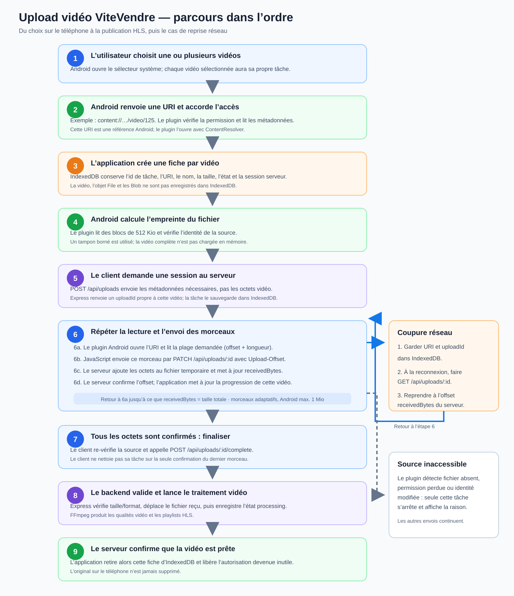

# README — Fonctionnement de l’upload vidéo

Ce document décrit les étapes de l’envoi d’une ou plusieurs vidéos dans ViteVendre et les fichiers qui réalisent chaque étape.

Le schéma graphique détaillé est également disponible dans [docs/schema-fonctionnement-upload-video.md](docs/schema-fonctionnement-upload-video.md).

## Résumé

Android fournit une URI `content://` pour chaque vidéo. L’application conserve cette URI et les métadonnées dans IndexedDB. Le plugin Cordova demande à Android de lire le fichier original par plages d’octets. JavaScript envoie chaque morceau au serveur. Le serveur confirme l’offset reçu et permet de reprendre au bon endroit après une interruption.

IndexedDB ne stocke jamais les octets de la vidéo, un Blob ou l’objet File. Le fichier original reste sur le téléphone.

## Carte des fichiers responsables

### Frontend JavaScript

| Fichier | Responsabilité |
|---|---|
| [`noteApp/www/js/main.js`](noteApp/www/js/main.js) | Crée l’interface principale et connecte les événements vidéo au gestionnaire d’upload. |
| [`noteApp/www/js/ui/queued-upload-ui.js`](noteApp/www/js/ui/queued-upload-ui.js) | Gère le bouton de sélection multiple, les commandes et l’affichage de chaque tâche. |
| [`noteApp/www/js/upload/native-video-source.js`](noteApp/www/js/upload/native-video-source.js) | Présente l’URI Android comme source lisible et appelle le pont Cordova. |
| [`noteApp/www/js/upload/source.js`](noteApp/www/js/upload/source.js) | Ouvre la source et calcule l’empreinte par blocs. |
| [`noteApp/www/js/upload/file-verification.js`](noteApp/www/js/upload/file-verification.js) | Regroupe les vérifications d’accès, d’existence, de lecture et d’identité. |
| [`noteApp/www/js/upload/upload-queue.js`](noteApp/www/js/upload/upload-queue.js) | Maintient les tâches, la limite de concurrence, la restauration et les états définitifs. |
| [`noteApp/www/js/upload/storage.js`](noteApp/www/js/upload/storage.js) | Persiste uniquement les champs de métadonnées autorisés dans IndexedDB. |
| [`noteApp/www/js/upload/upload-task.js`](noteApp/www/js/upload/upload-task.js) | Pilote une session vidéo : création, envoi par morceaux, pause, reprise et finalisation. |
| [`noteApp/www/js/upload/chunk-sizer.js`](noteApp/www/js/upload/chunk-sizer.js) | Adapte la taille des morceaux selon les transferts confirmés et les limites serveur. |
| [`noteApp/www/js/api-core.js`](noteApp/www/js/api-core.js) | Envoie les requêtes HTTP de session, statut, morceau, finalisation et annulation. |
| [`noteApp/www/js/services/network.js`](noteApp/www/js/services/network.js) | Informe l’interface des changements de connectivité; les reprises d’upload sont orchestrées par `upload-task.js`. |

### Pont natif Android

| Fichier | Responsabilité |
|---|---|
| [`noteApp/cordova-plugins/vitevendre-persistent-video/plugin.xml`](noteApp/cordova-plugins/vitevendre-persistent-video/plugin.xml) | Déclare le plugin Cordova et associe son interface JavaScript à sa classe Android. |
| [`noteApp/cordova-plugins/vitevendre-persistent-video/www/vv-video-source.js`](noteApp/cordova-plugins/vitevendre-persistent-video/www/vv-video-source.js) | Transmet les actions JavaScript au service natif Cordova `VvVideoSource`. |
| [`noteApp/cordova-plugins/vitevendre-persistent-video/src/android/VvVideoSource.java`](noteApp/cordova-plugins/vitevendre-persistent-video/src/android/VvVideoSource.java) | Sélectionne les URI, vérifie les permissions, calcule l’empreinte native et lit les plages via `ContentResolver`. |

### Backend Node.js

| Fichier | Responsabilité |
|---|---|
| [`backend/src/routes/upload.routes.js`](backend/src/routes/upload.routes.js) | Déclare les cinq opérations HTTP et applique l’authentification. |
| [`backend/src/controllers/upload.controller.js`](backend/src/controllers/upload.controller.js) | Reçoit les demandes, écrit les morceaux, vérifie l’offset et finalise ou annule les sessions. |
| [`backend/src/models/upload.model.js`](backend/src/models/upload.model.js) | Enregistre les sessions, leur état et le nombre d’octets confirmés dans PostgreSQL. |
| [`backend/src/services/gc.service.js`](backend/src/services/gc.service.js) | Nettoie les sessions abandonnées et les fichiers temporaires orphelins après le TTL. |
| [`backend/src/services/transcode-queue.service.js`](backend/src/services/transcode-queue.service.js) | Place les vidéos finalisées dans la file de traitement et récupère les traitements après redémarrage. |
| [`backend/src/services/ffmpeg.service.js`](backend/src/services/ffmpeg.service.js) | Transcode la source en qualités vidéo et prépare les playlists HLS. |
| [`backend/src/services/events.service.js`](backend/src/services/events.service.js) | Diffuse les événements de publication au client. |

## Parcours étape par étape

### 1. L’application affiche le sélecteur et la file d’envoi

- [`noteApp/www/js/main.js`](noteApp/www/js/main.js) initialise l’interface et crée le gestionnaire d’uploads.
- [`noteApp/www/js/ui/queued-upload-ui.js`](noteApp/www/js/ui/queued-upload-ui.js) affiche « Ajouter des vidéos », ouvre le sélecteur et rend les lignes de progression.
- Sur Android, l’utilisateur peut sélectionner plusieurs vidéos en une opération. Le nombre d’uploads simultanés est réglable et vaut deux par défaut.

### 2. Android renvoie une URI pour chaque vidéo

- [`noteApp/www/js/upload/native-video-source.js`](noteApp/www/js/upload/native-video-source.js) appelle l’interface JavaScript `cordova.plugins.vvVideoSource` et crée un objet `AndroidContentFile` par vidéo.
- [`noteApp/cordova-plugins/vitevendre-persistent-video/www/vv-video-source.js`](noteApp/cordova-plugins/vitevendre-persistent-video/www/vv-video-source.js) transmet les appels JavaScript au service natif Cordova `VvVideoSource`.
- [`noteApp/cordova-plugins/vitevendre-persistent-video/plugin.xml`](noteApp/cordova-plugins/vitevendre-persistent-video/plugin.xml) déclare le plugin et sa classe Android.
- [`noteApp/cordova-plugins/vitevendre-persistent-video/src/android/VvVideoSource.java`](noteApp/cordova-plugins/vitevendre-persistent-video/src/android/VvVideoSource.java) ouvre `ACTION_OPEN_DOCUMENT`, récupère les URI et métadonnées, puis demande une permission de lecture persistante lorsque le fournisseur Android l’autorise.

Une URI `content://…` est une référence que le système Android sait résoudre. JavaScript dans la WebView ne l’ouvre pas directement comme un fichier local ordinaire.

### 3. Une fiche IndexedDB est créée par vidéo

- [`noteApp/www/js/upload/upload-queue.js`](noteApp/www/js/upload/upload-queue.js) donne un identifiant unique à chaque tâche et empêche l’ajout en double de la même référence.
- [`noteApp/www/js/upload/storage.js`](noteApp/www/js/upload/storage.js) enregistre uniquement les métadonnées dans le magasin IndexedDB `vitevendre-uploads`, magasin `tasks`.

Une fiche comprend notamment `id`, `uri`, `name`, `mimeType`, `size`, `lastModified`, `status`, `uploadSessionId` et une progression locale indicative. L’identifiant de tâche, l’URI et l’identifiant de session gardent ensemble les informations d’une vidéo.

### 4. Le client vérifie la source et prépare la session

- [`noteApp/www/js/upload/source.js`](noteApp/www/js/upload/source.js) choisit comment lire une source et calcule son empreinte.
- [`noteApp/www/js/upload/file-verification.js`](noteApp/www/js/upload/file-verification.js) regroupe les contrôles d’accès, de lecture et d’identité.
- Pour Android, le calcul de l’empreinte complète est effectué dans le code natif par blocs de 512 Kio, avec un tampon borné. Le fichier complet n’est pas chargé en mémoire.
- [`noteApp/www/js/upload/upload-task.js`](noteApp/www/js/upload/upload-task.js) appelle ensuite `POST /api/uploads` via [`noteApp/www/js/api-core.js`](noteApp/www/js/api-core.js). Cette requête envoie les métadonnées nécessaires, pas la vidéo.
- Le backend renvoie un `uploadId` propre à la tâche. `upload-queue.js` le sauvegarde dans la fiche IndexedDB.

### 5. Le client lit et envoie les morceaux

- `upload-task.js` choisit l’offset confirmé, demande la lecture de la plage correspondante, puis envoie les octets avec `PATCH /api/uploads/:id` et l’en-tête `Upload-Offset`.
- `AndroidContentFile.read()` dans `native-video-source.js` appelle `readRange`.
- `VvVideoSource.java` vérifie l’accès et les métadonnées, puis utilise `ContentResolver`, `ParcelFileDescriptor` et `FileChannel` pour lire uniquement la plage demandée.
- Le morceau passe temporairement par JavaScript pour être envoyé. La vidéo entière n’est pas conservée en mémoire.
- [`noteApp/www/js/upload/chunk-sizer.js`](noteApp/www/js/upload/chunk-sizer.js) adapte la taille aux transferts observés. Android est plafonné à 1 Mio et le client respecte aussi la limite renvoyée par le serveur.

### 6. Le serveur enregistre chaque morceau et confirme sa position

- [`backend/src/routes/upload.routes.js`](backend/src/routes/upload.routes.js) déclare les routes de création, état, morceaux, finalisation et annulation.
- [`backend/src/controllers/upload.controller.js`](backend/src/controllers/upload.controller.js) traite les requêtes. Pour chaque `PATCH`, il écrit les octets reçus dans le fichier temporaire de cette session.
- [`backend/src/models/upload.model.js`](backend/src/models/upload.model.js) enregistre l’état de la session et `received_bytes` dans PostgreSQL.
- Le client met à jour la progression individuelle après la confirmation du serveur.

Les morceaux sont transmis dans l’ordre. Le serveur suit donc un offset cumulatif `receivedBytes` plutôt qu’une liste de numéros de morceaux.

### 7. Une coupure déclenche une reprise depuis la source de vérité serveur

- `upload-task.js` interrompt ou réessaie une requête temporairement en échec, puis appelle `GET /api/uploads/:id`.
- `upload-queue.js` restaure les tâches depuis IndexedDB au lancement suivant et rouvre l’URI avec `reopenFile()`.
- Le serveur renvoie `receivedBytes`. Cette valeur, et non `uploadedBytes` local, décide d’où reprendre.
- Le plugin Android rouvre la même URI si la permission et le fichier sont toujours disponibles; l’envoi continue à l’offset confirmé.

Le service [`noteApp/www/js/services/network.js`](noteApp/www/js/services/network.js) signale l’état général du réseau à l’interface. La gestion des requêtes d’upload, des délais et de la reprise par offset se trouve dans `upload-task.js`.

### 8. Le backend finalise, puis traite la vidéo

- `upload-task.js` envoie `POST /api/uploads/:id/complete` quand tous les octets sont confirmés et que la vérification finale de la source réussit.
- `upload.controller.js` vérifie la taille et le format du fichier temporaire, le déplace vers le stockage source du serveur et met l’enregistrement en traitement.
- [`backend/src/services/transcode-queue.service.js`](backend/src/services/transcode-queue.service.js) lance le traitement asynchrone.
- [`backend/src/services/ffmpeg.service.js`](backend/src/services/ffmpeg.service.js) produit les qualités et playlists HLS.
- [`backend/src/services/events.service.js`](backend/src/services/events.service.js) notifie le client quand la vidéo est prête.
- `queued-upload-ui.js` reçoit l’événement et demande à `upload-queue.js` de retirer la tâche d’IndexedDB et de libérer l’autorisation Android devenue inutile.

## Comment une vidéo est distinguée des autres

| Élément | Rôle |
|---|---|
| `id` | Identifie la tâche dans la file locale et sert de clé dans IndexedDB. |
| `uri` | Indique à Android quel fichier original rouvrir. |
| `uploadSessionId` (`uploadId`) | Indique au serveur quel transfert consulter ou reprendre. |
| `receivedBytes` | Offset confirmé par le serveur; source de vérité pour la reprise. |

Exemple : la tâche `tache-A` conserve l’URI `content://…/125` et `session-A`; la tâche `tache-B` conserve l’URI `content://…/348` et `session-B`. Les morceaux et progressions ne sont ainsi pas mélangés.

## Fichier supprimé ou inaccessible

Si Android ne peut plus ouvrir une URI, `upload-task.js` signale l’échec à `upload-queue.js`. La tâche concernée devient définitive, son message affiche son nom et sa raison, et elle sort de la file active. Les autres tâches continuent. Le nettoyage de la session serveur est tenté en arrière-plan; le fichier original du téléphone n’est jamais supprimé.

## Limite du fonctionnement en arrière-plan

IndexedDB conserve les références et métadonnées, mais ne garde pas le JavaScript actif. Si Android ferme l’application, l’upload s’arrête; il peut reprendre à la prochaine ouverture si l’URI et sa permission restent valides.
