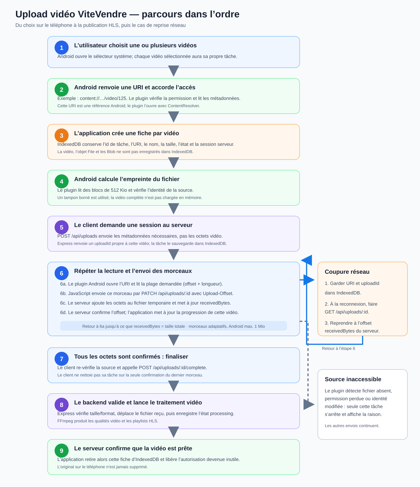

# Fonctionnement de l'upload vidéo ViteVendre

Ce schéma décrit le trajet d'une vidéo depuis sa sélection sur Android jusqu'à sa publication, ainsi que la reprise d'un transfert interrompu.

## Parcours

1. **Sélection** — Android peut renvoyer plusieurs URI `content://`. Le plugin récupère le nom, le type et la taille de chaque vidéo.
2. **Association locale** — La file crée une tâche par vidéo. IndexedDB garde l'URI, l'état et l'`uploadId` de cette tâche; il ne stocke pas les octets vidéo.
3. **Session serveur** — `POST /api/uploads` crée ou reprend une ligne `uploads`, liée à un `videoId` distinct.
4. **Transfert par morceaux** — Le client envoie chaque plage avec `PATCH /api/uploads/:id` et `Upload-Offset`. Le backend écrit un fichier `<uploadId>.<chunkNumber>.part` dans `uploads/sessions/`; `upload_chunks` conserve seulement sa référence. Le serveur calcule les offsets et tailles depuis les fichiers.
5. **Plusieurs vidéos** — Chaque vidéo a son `videoId`, son `uploadId` et ses lignes de morceaux. Le nombre de tâches envoyées simultanément est réglable et vaut deux par défaut.
6. **Coupure et reprise** — Après reconnexion ou redémarrage, l'application demande au serveur l'état de son `uploadId`. Le serveur calcule `receivedBytes` depuis les tailles des `.part` référencés; le client relit la source à cette position.
7. **Finalisation** — Le backend contrôle les références et offsets, puis fournit à FFmpeg un manifeste ordonné des `.part`. FFmpeg les lit comme un flux continu et produit `uploads/sources/<videoId>.mp4`; le backend marque l'upload complet et supprime les lignes et fichiers temporaires des morceaux.
8. **Transcodage** — Le serveur transmet le MP4 à la file FFmpeg, qui produit le streaming HLS.

## Identifiants

| Valeur | Rôle |
|---|---|
| `videos.id` (`videoId`) | Identifie la vidéo publiée et son transcodage. |
| `uploads.id` (`uploadId`) | Identifie la session reprenable d'une vidéo. |
| `upload_chunks.chunk_number` | Identifie l'ordre d'un morceau dans cette session. |
| `upload_chunks.part_name` | Référence vers le fichier `.part`; l'ordre des références détermine l'assemblage. |

La base garantit le lien session/vidéo avec une clé étrangère composite. La ligne `videos` et son `source_name` restent en base après traitement; les morceaux `.part` sont supprimés après la création vérifiée du MP4. Une session abandonnée est nettoyée après 24 heures.
