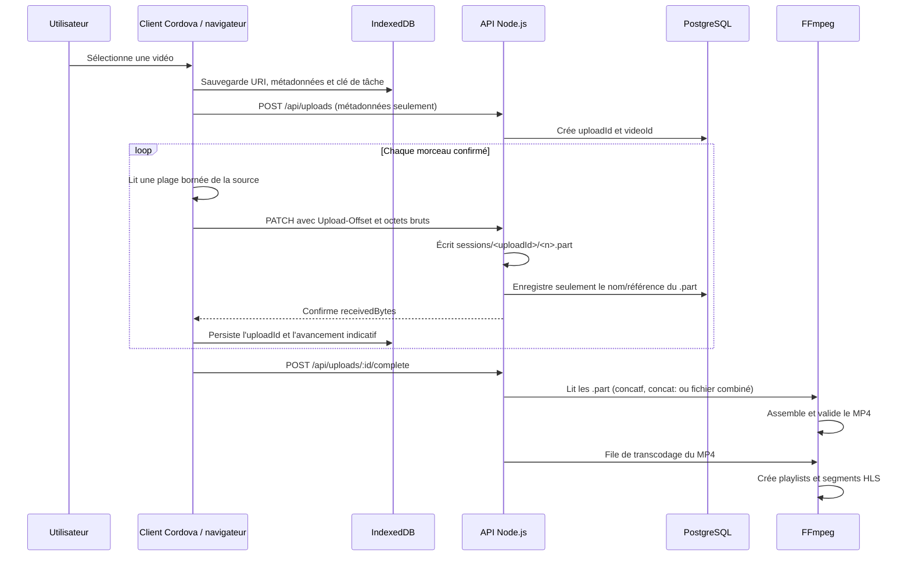

# Fonctionnement de l’upload vidéo, du client au serveur

Ce document décrit le parcours actif utilisé par l’application ViteVendre : sélection d’une vidéo, reprise après coupure, sauvegarde des morceaux `.part`, assemblage MP4 par FFmpeg, puis création du flux HLS.

## Ce que montrait la capture

La capture indique `0 % · 1 Ko`. Ce `1 Ko` ne correspondait pas à un morceau envoyé : `formatBytes(0)` arrondissait zéro à un minimum de 1 Ko. De plus, l’interface affichait « Envoi » pendant que le téléphone lisait encore le premier morceau.

Le parcours distingue maintenant ces étapes :

1. `Vérification` : contrôle rapide de la source et des autorisations.
2. `Lecture du morceau` : lit une plage du fichier original sur le téléphone.
3. `Envoi` : transmet cette plage par `PATCH` et attend sa confirmation du serveur.

Le premier morceau fait maintenant 512 Kio. Les suivants s’ajustent au débit observé, de 512 Kio jusqu’à 4 Mio. L’affichage indique `0 o` tant que le serveur n’a confirmé aucun octet.

## Vue générale



## 1. Sélection de la vidéo et URI Android

Sur Android, le sélecteur `ACTION_OPEN_DOCUMENT` fournit une URI `content://` et une autorisation de lecture persistante. Le client conserve cette URI pour pouvoir rouvrir le fichier après fermeture de l’application. Dans le navigateur, le sélecteur fournit un objet `File`.

Fichiers responsables :

- `noteApp/www/js/ui/queued-upload-ui.js` ouvre le sélecteur et crée une tâche pour chaque vidéo choisie.
- `noteApp/cordova-plugins/vitevendre-persistent-video/src/android/VvVideoSource.java` demande au système Android l’accès persistant et lit les plages demandées.
- `noteApp/cordova-plugins/vitevendre-persistent-video/www/vv-video-source.js` relie les appels JavaScript aux actions Cordova natives.
- `noteApp/www/js/upload/native-video-source.js` représente l’URI comme une source lisible par plages.
- `noteApp/www/js/upload/source.js` fournit la même interface de lecture pour les objets `File` du navigateur.

L’application ne copie pas le fichier original dans son propre dossier. Elle relit la source à la demande.

## 2. IndexedDB garde la reprise, pas la vidéo

`noteApp/www/js/upload/storage.js` filtre les propriétés avant chaque écriture IndexedDB. La fiche locale peut contenir :

- l’URI Android et son type;
- le nom, le type MIME, la taille déclarée et la date du fichier;
- une clé aléatoire propre à cette tâche;
- l’`uploadId`, le `videoId`, l’état et l’avancement confirmé;
- la légende et l’ordre dans la file.

IndexedDB ne contient aucun octet vidéo, `Blob` ou objet `File`. `noteApp/www/js/upload/upload-queue.js` restaure les fiches au lancement, rouvre l’URI Android, et reprend la tâche avec le même `uploadId`.

La métadonnée numérique `size` est conservée dans l’IndexedDB du téléphone pour afficher la progression et vérifier que la source est toujours la même. Elle ne contient pas le fichier. La règle « aucune taille ni aucun octet vidéo en base » concerne PostgreSQL côté serveur : La taille attendue y est conservée dans le petit fichier `uploads/sessions/<uploadId>/meta.json`, et les octets restent dans les `.part`.

## 3. Vérification rapide et création de session

Pour une nouvelle tâche, `noteApp/www/js/upload/source.js` génère une clé aléatoire `session-key-v2`. `upload-queue.js` l’enregistre dans IndexedDB avant la première requête. La clé permet au serveur de reconnaître une répétition du même `POST` si la réponse réseau est perdue; ce n’est pas un hachage du contenu.

`noteApp/www/js/upload/upload-task.js` vérifie l’accès et lit un octet pour confirmer que la source est disponible. Il n’effectue plus une lecture complète de la vidéo avant l’envoi. Lors d’une reprise Android, `file-verification.js` et `AndroidContentFile.checkFilePermission()` vérifient l’autorisation, le nom, la taille et les métadonnées disponibles. Les anciens envois utilisant `content-chain-v1` restent reconnus; la file les convertit vers une clé de tâche rapide lors de leur restauration.

La clé rapide n'est pas une empreinte cryptographique du contenu. Si un fournisseur modifie une vidéo en place tout en gardant la même URI, taille et métadonnées, ce changement peut ne pas être détecté; FFmpeg vérifie que le résultat est un média lisible, pas qu'il correspond à une empreinte complète du fichier original.

Le client appelle ensuite `POST /api/uploads` via `noteApp/www/js/api-core.js`. Cette requête JSON transporte les métadonnées, la taille attendue et la clé de session, pas le contenu vidéo. Le serveur crée une session `uploadId` et une vidéo `videoId`, avec son propre dossier `uploads/sessions/<uploadId>/`. La taille attendue est conservée dans `uploads/sessions/<uploadId>/meta.json`, pas dans une colonne de taille PostgreSQL.

Fichiers serveur : `backend/src/routes/upload.routes.js` expose les routes; `backend/src/controllers/upload.controller.js` valide la requête; `backend/src/models/upload.model.js` crée la ligne de session et la ligne vidéo.

## 4. Lecture et adaptation de la taille des morceaux

`noteApp/www/js/upload/chunk-sizer.js` démarre à 512 Kio. Après chaque `PATCH` confirmé, il mesure le temps de la requête, lisse le débit et ajuste progressivement la taille pour viser environ deux secondes par morceau. Jusqu’à environ 512 Kio/s, il reste à 512 Kio; au-dessus, il peut monter jusqu’à 4 Mio. Après une erreur, il revient à 512 Kio. Le navigateur, Android et le serveur partagent le plafond de 4 Mio; le pont Android natif lit lui aussi des plages jusqu’à cette limite.

Pour chaque itération, `UploadTask` :

1. prend le prochain offset confirmé par le serveur;
2. émet l’état `reading-chunk` et lit cette plage avec `file.slice()` ou `readRange` Android;
3. émet l’état `uploading` et envoie le morceau par `PATCH`;
4. attend la réponse serveur avant d’avancer l’offset et la progression;
5. si le réseau échoue, appelle `GET /api/uploads/:id` et repart de `receivedBytes`.

Les morceaux arrivent dans l’ordre. Un `Upload-Offset` inattendu renvoie **409** et l’offset réel, ce qui empêche d’ajouter un morceau au mauvais endroit.

Fichiers client : `noteApp/www/js/upload/upload-task.js`, `noteApp/www/js/upload/chunk-sizer.js`, `noteApp/www/js/upload/file-verification.js`, `noteApp/www/js/upload/native-video-source.js` et `noteApp/www/js/api-core.js`.

## 5. Ce qui passe en mémoire et ce qui est écrit sur disque

Le fichier complet n’est jamais chargé dans la mémoire du client ou du serveur. Un seul morceau borné est traité à la fois. Sur Android, le plugin natif lit ce morceau dans un tampon et le renvoie temporairement en Base64 au JavaScript; le JavaScript le décode avant le `PATCH`. La requête réseau contient ensuite les octets bruts. Node.js garde temporairement le morceau courant pour vérifier sa longueur et l’écrire sur disque.

Cela signifie « pas de vidéo entière en RAM », et non « zéro octet temporaire en mémoire ». Envoyer sans aucun tampon nécessiterait un mécanisme natif de transfert HTTP en flux; le navigateur et le pont Cordova actuels transmettent une plage bornée à la fois.

## 6. Réception serveur et fichiers `.part`

### Fichiers qui reçoivent un morceau

1. `backend/src/routes/upload.routes.js` déclare `PATCH /api/uploads/:id` et exige un utilisateur authentifié.
2. `backend/src/app.js` active le parseur JSON pour les requêtes JSON, mais laisse le corps `application/octet-stream` du `PATCH` intact.
3. `backend/src/controllers/upload.controller.js`, fonction `appendChunk()`, vérifie la session, `Upload-Offset`, `Content-Length` et la limite configurée. `readChunkBody()` lit exactement cette longueur et refuse un corps interrompu ou trop grand.
4. Le contrôleur écrit le morceau complet dans un fichier temporaire `*.incoming.tmp` sous `uploads/sessions/<uploadId>/`.
5. `backend/src/models/upload.model.js`, fonction `appendChunk()`, verrouille la session, renomme ce temporaire en `.part`, puis insère la petite référence en base. Si la réception n'est pas complète, le modèle n'est pas appelé et aucun `.part` confirmé n'est référencé.

Le chemin final est :

```text
uploads/sessions/<uploadId>/<chunkNumber>.part
```

Le corps HTTP et un seul morceau passent temporairement par la mémoire pendant la validation et l'écriture. Le fichier complet n'est jamais assemblé en mémoire par Node.

### Ce que PostgreSQL stocke exactement

Le schéma actif est défini dans `backend/database/schema.sql`. Les lignes de morceaux sont volontairement petites :

| Table | Colonnes conservées | Ce qui n'y est pas stocké |
|---|---|---|
| `upload_chunks` | `upload_id`, `video_id`, `chunk_number`, `part_name`, `created_at` | Octets vidéo, taille du morceau et offset en octets |
| `uploads` | `id`, `user_id`, `video_id`, `mime_type`, clé de tâche `fingerprint`, `status`, dates | Taille totale réelle/déclarée et nombre d'octets reçus |
| `videos` | Identifiant, propriétaire, état, légende et nom de la source MP4; métadonnées de publication après transcodage | Octets du MP4 ou taille réelle du fichier |

`chunk_number` est seulement un numéro d'ordre (0, 1, 2…), et `part_name` est un nom de fichier. Ce ne sont pas des tailles ou des offsets en octets. La clé `fingerprint` actuelle est une clé aléatoire de session de 64 caractères, pas le contenu vidéo.

`total_size` est reçu par l'API pour contrôler la fin, puis conservé dans `uploads/sessions/<uploadId>/meta.json`, jamais dans PostgreSQL. Pour recalculer `receivedBytes`, `upload.model.js` lit les lignes de référence et fait `fs.stat()` sur chaque `.part`; il additionne les tailles retournées par le système de fichiers sans les écrire en base. Les tailles sont donc calculées à la demande, pas persistées.

Les anciennes colonnes `uploads.total_size`, `uploads.received_bytes`, `upload_chunks.data`, `chunk_size` et `byte_offset` sont supprimées par le schéma. `backend/scripts/db-init.js` exporte d'abord d'anciennes données `BYTEA` dans des fichiers `.part`; pour appliquer la migration à une ancienne base, lancer `npm run db:init` depuis `backend/`.

Si le serveur affiche `une valeur NULL viole la contrainte NOT NULL ... uploads.total_size`, il utilise encore l'ancien schéma PostgreSQL. Arrêter l'API, lancer `npm run db:init` depuis `backend/`, puis redémarrer l'API. Cette commande migre les anciennes tailles et les morceaux présents avant de supprimer les colonnes obsolètes. Ne pas lancer `npm run db:reset` pour corriger cette erreur : cette commande efface les tables.

`backend/src/services/gc.service.js` supprime les morceaux des sessions abandonnées et les fichiers temporaires orphelins.

## 7. Réassemblage des `.part` par FFmpeg en MP4

Quand tous les octets sont confirmés, le client appelle `POST /api/uploads/:id/complete`. Voici les fichiers qui réalisent l'assemblage :

1. **`backend/src/controllers/upload.controller.js` — `prepareFfmpegInput()`** vérifie que les numéros sont consécutifs, que chaque référence correspond exactement à `<n>.part` dans le dossier de session `uploads/sessions/<uploadId>/`, que le fichier existe et que la somme de `stat.size` correspond au total déclaré. Cette somme est calculée depuis le disque.
2. La même fonction demande ensuite la liste des protocoles réellement supportés par le FFmpeg installé (`supportedProtocols()`, mise en cache), puis choisit la méthode d'assemblage :
   - **`concatf:`** (FFmpeg >= 8) : elle écrit un manifeste texte contenant les noms validés, un nom par ligne. Le manifeste est léger : il contient des chemins, pas des octets vidéo.
   - **`concat:`** (présent dans toutes les versions de FFmpeg) : les noms des `.part` sont joints par `|` dans une seule URL de protocole, plafonnée à 16 000 caractères pour tenir dans la ligne de commande.
   - **Concaténation Node** (dernier repli si aucun protocole `concat` n'existe) : `concatPartsToFile()` recopie les `.part` un par un dans `uploads/sessions/<uploadId>/combined.tmp` via des streams, sans jamais charger le fichier complet en mémoire.
3. **`backend/src/controllers/upload.controller.js` — `completeUpload()`** transmet l'entrée choisie à `assembleMp4()` et demande à FFmpeg d'écrire d'abord un fichier temporaire `uploads/sources/<uploadId>.assembling.mp4`. Le manifeste `concat.tmp` est **conservé** dans le dossier de session (entrées .part réutilisable tel quel) ; seul le combined.tmp du repli Node est supprimé après l'assemblage.
4. **`backend/src/services/ffmpeg.service.js` — `assembleMp4()`** lance FFmpeg avec l'entrée préparée. FFmpeg ouvre lui-même chaque `.part` dans l'ordre et les lit comme un seul flux continu d'octets. Il remuxe les codecs compatibles MP4; si nécessaire, il réencode la vidéo en H.264 et l'audio en AAC.
5. `ffprobe` valide que la sortie est un MP4 lisible. Le contrôleur le renomme alors `uploads/sources/<videoId>.mp4`, met à jour l'état de la vidéo et retire les références PostgreSQL. Les `.part` RESTENT dans le dossier de session : ce sont des fichiers persistants, reconstituables à la demande.

Les `.part` sont des plages arbitraires d'une même vidéo, pas des vidéos séparées à concaténer par leurs pistes. Node vérifie les références et, dans le repli final, recopie les octets en streams; sinon **FFmpeg est le programme qui assemble les octets en MP4**. Cette chaîne de replis garantit qu'une version ancienne de FFmpeg (par exemple 4.4 sur Ubuntu 22.04, sans `concatf:`) n'interrompt plus la publication avec l'erreur « FFmpeg ne peut pas assembler ce fichier en MP4 ».

Chaque `uploadId` correspond à une vidéo. Si plusieurs vidéos sont sélectionnées, chacune a son propre `uploadId`, ses `.part` et son MP4.

## 8. Traitement FFmpeg en HLS

Après création du MP4, `backend/src/services/transcode-queue.service.js` place le `videoId` dans la file. Le service relit le MP4 validé et appelle `processVideo()` dans `backend/src/services/ffmpeg.service.js`. Ce deuxième passage FFmpeg produit les qualités, playlists HLS et segments; l'affiche est extraite du MP4. La source MP4 est supprimée après le transcodage réussi. Les clients lisent ensuite les playlists et segments depuis le serveur.

## 9. Robustesse de l'assemblage

Trois mécanismes évitent que l'échec d'un assemblage détruise les preuves ou bloque la publication :

1. **Chemins absolus** : `backend/src/config/env.js` applique `path.resolve()` à `UPLOAD_DIR` et `MEDIA_DIR`, même quand le `.env` contient une valeur relative (`./uploads`). FFmpeg reçoit un chemin de sortie absolu : une valeur relative dans le `.env` faisait autrefois échouer l'ouverture du fichier (erreur `No such file or directory`).
2. **Chaîne de replis** : `prepareFfmpegInput()` essaie `concatf:`, puis `concat:`, puis la concaténation Node en streams (voir section 7). `supportedProtocols()` lit une fois `ffmpeg -protocols` et met le résultat en cache; un FFmpeg sans `concatf` (par exemple 4.4) retombe proprement sur `concat:`.
3. **Réessais et conservation** : `completeUpload()` relance l'assemblage jusqu'à 3 fois (`assembleWithRetry`, pause progressive de 300 ms × tentative) contre les verrouillages de fichiers transitoires de Windows ou de l'antivirus. En cas d'échec définitif (422), le serveur journalise `upload_assembly_failed`, écrit le détail stderr dans `uploads/sessions/<uploadId>/assembly-error.log` et **conserve** le dossier de session et les `.part` : la publication reste relançable (« Reprendre ») et reproductible octet pour octet. Le GC (`gc.service.js`) range plus tard les sessions abandonnées et les orphelins.

Le cycle de vie d'une session, depuis le passage à un dossier par session : à la création, le contrôle crée `uploads/sessions/<uploadId>/` et y écrit `meta.json` (`ensureUploadMetadata()`). Assemblage réussi : le contrôleur supprime uniquement les temporaires (`combined.tmp`, `*.incoming.tmp`) — **les `.part`, `meta.json` et le manifeste `concat.tmp` restent** dans le dossier : fichiers persistants et ré-assemblables sans rien recréer. Session retirée, échec ou abandon : rm récursif, plus rien (le manifeste est conservé sur échec d'assemblage seulement, pour relancer). Le GC supprime ensuite le dossier entier dès qu'il n'est plus `in_progress` et que son mtime dépasse le TTL de 24 h.

## 10. Formats et codecs acceptés

Les conteneurs en entrée : `video/mp4`, `video/quicktime` (MOV, iPhone), `video/webm`, `video/3gpp`. Le H.265/HEVC des iPhone est géré sans réglage : l'assemblage `-c copy` remet le HEVC (`hvc1`) tel quel dans l'enveloppe MP4, puis la passe HLS **décode entièrement** la source et réencode toujours en H.264/AAC (`libx264`), quel que soit le codec d'entrée. Conséquences visibles :

| Codec d'entrée | Assemblage MP4 | HLS final |
|---|---|---|
| H.264 + AAC | copie sans réencodage | H.264/AAC 240p → 1080p |
| H.265/HEVC (iPhone) | copie sans réencodage | décodé puis réencodé H.264/AAC |
| VP9/Opus (WebM) | souvent réencodé (repli libx264) | décodé puis réencodé H.264/AAC |

Deux points d'attention : le décodage HEVC est plus coûteux en CPU (transcodage plus lent, mais correct); une source HDR 10 bits est convertie en 8 bits sans tone-mapping, les couleurs vives du HDR peuvent paraître légèrement délavées.

## 11. Tester sans l'application : découper puis assembler des `.part`

Deux scripts de `backend/scripts/` reproduisent hors application les deux moitiés du parcours : le découpage côté client et l'assemblage côté serveur. Ils utilisent le même layout que le serveur — un dossier par session `uploads/sessions/<uploadId>/`, des `.part` nommés `<n>.part`, le même `meta.json` et le même plafond de morceau; l'assemblage appelle les **mêmes fonctions de production** que `completeUpload()`. Ils servent donc à déboguer l'assemblage FFmpeg en ligne de commande, sans le téléphone, sans PostgreSQL et sans l'API.

```powershell
cd C:\Users\Further Market\Downloads\vitevendre-v2\backend

# 1) Découper une vidéo en .part (par défaut : morceaux de 4 Mio dans uploads/sessions/)
npm run parts:split -- "C:\chemin\vers\ma-video.mp4"
node scripts/split-to-parts.js "C:\chemin\vers\ma-video.mp4" --size 1048576
node scripts/split-to-parts.js "C:\chemin\vers\ma-video.mp4" --id 030d25ca-cf2c-4aa3-b74a-b62e98eed34e

# 2) Réassembler cette session avec la chaîne du serveur (concatf/concat/Node + ffprobe)
npm run parts:assemble -- 030d25ca-cf2c-4aa3-b74a-b62e98eed34e
#    Sortie par défaut : uploads/sessions/<uploadId>/<uploadId>.assembled.mp4, lisible dans VLC.
node scripts/assemble-parts.js --help
```

`parts:split` affiche les commandes de réassemblage manuel à copier-coller (chaîne `concat:` identique au serveur, `ffprobe`, variante `copy /b`, nettoyage). `parts:assemble` valide les morceaux comme `prepareFfmpegInput()` (numéros consécutifs, référence exacte `<n>.part`, somme des tailles = taille annoncée du `meta.json`), choisit l'entrée `concatf:` → `concat:` (≤ 16 000 caractères) → concaténation Node, appelle la vraie `assembleMp4()` (copie `-c copy`, repli réencodage H.264/AAC, validation ffprobe), supprime ses temporaires et affiche le stderr FFmpeg en cas de refus (l'équivalent hors API du journal `upload_assembly_failed`).

Vérification faite sur ce dépôt : découpage en 3 morceaux de 32 Kio, réassemblage `concat:`, durée et taille FFprobe conformes et concaténation binaire des `.part` identique à l'original octet pour octet; assemblage via `parts:assemble` sur 4 morceaux : MP4 H.264/AAC de 4 s validé par ffprobe, `.part` recollés identiques à l'original, temporaires supprimés; et un morceau retiré produit bien l'erreur « Numéros non consécutifs » attendue côté serveur.

## 12. Variante de test : conserver un MP4 lisible après l'upload

En production, aucun MP4 ne subsiste : la file HLS lit `uploads/sources/<videoId>.mp4` puis `transcode-queue.service.js` supprime la source après transcodage réussi. Pour inspecter le MP4 assemblé depuis l'upload réel (VLC, ffprobe, comparaison avec l'original), `backend/src/controllers/upload.controller.js` contient deux variantes côte à côte, activables en commentant/décommentant :

- **Variante A** (active) : `fsp.rename(assemblingFile, sourcePath)` — sortie provisoire, supprimée par la file après HLS.
- **Variante B** (commentée) : ajout d'une copie conservée `uploads/sources/<videoId>.assembled-test.mp4` après le renommage. Rien ne la supprime : la file ne retire que `<videoId>.mp4`, le GC ne touche que `uploads/sessions`. Décommentez, redémarrez l'API, envoyez une vidéo, inspectez le fichier, puis recommentez pour ne pas remplir le disque.

## 13. Pour chaque cas : quel fichier gère quoi, quelle commande

| Cas | Fichier qui le gère | Commande / mécanisme exact |
|---|---|---|
| Découper une vidéo en `.part` pour test | `backend/scripts/split-to-parts.js` | `npm run parts:split -- video.mp4` (lecture par plages, écriture `sessions/<uploadId>/<n>.part`) |
| Réassembler les `.part` hors application | commandes affichées par le script | `ffmpeg -i "concat:p.0.part|p.1.part|..." -map 0:v:0 -map 0:a? -sn -dn -c copy -movflags +faststart out.mp4` |
| Choisir la méthode d'assemblage (serveur) | `backend/src/controllers/upload.controller.js` — `prepareFfmpegInput()` | `concatf:` manifeste → URL `concat:` (≤ 16 000 caractères) → `concatPartsToFile()` Node en streams |
| Assembler en MP4 (serveur) | `backend/src/services/ffmpeg.service.js` — `assembleMp4()` | `-c copy -movflags +faststart`, repli `-c:v libx264 -preset veryfast -crf 23 -pix_fmt yuv420p -c:a aac -b:a 128k` |
| Valider la sortie | `ffmpeg.service.js` — `probe()` + `looksLikeVideo()` | `ffprobe` du MP4; contrôle des octets `ftyp`/EBML du fichier assemblé |
| Transcoder en HLS | `ffmpeg.service.js` — `processVideo()` / `buildHlsArgs()` | un seul décodage, `split` vers chaque qualité, `libx264 -preset veryfast`, AAC 44.1 kHz, `-f hls -hls_time 2` en `.ts` + `index.m3u8` par qualité |
| Mettre le MP4 dans la file, puis le supprimer | `backend/src/services/transcode-queue.service.js` | `enqueue(videoId)` à la fin de `completeUpload`; `fs.unlink` de la source après transcodage |
| Nettoyer sessions abandonnées et orphelins | `backend/src/services/gc.service.js` | TTL 24 h (`uploadSessionTtlHours`) : rm récursif `sessions/<uploadId>/` (et reliques de l'ancien layout plat) dès que la session n'est plus `in_progress` |
| Échec d'assemblage : diagnostic | `upload.controller.js` + `backend/src/middlewares/errorHandler.js` | journal `upload_assembly_failed` + `uploads/sessions/<uploadId>/assembly-error.log`, dossier de session et `.part` conservés |
| Variante de test avec MP4 conservé | `upload.controller.js` — VARIANTE B commentée | décommenter `fsp.copyFile(assemblingFile, ...assembled-test.mp4)` |

## Fichiers à consulter par étape

| Étape | Fichier principal |
|---|---|
| Sélecteur, file et affichage de progression | `noteApp/www/js/ui/queued-upload-ui.js` |
| URI persistante Android et lecture native par plage | `noteApp/cordova-plugins/vitevendre-persistent-video/src/android/VvVideoSource.java` |
| Enregistrement des URI, clés de tâche et sessions pour reprise | `noteApp/www/js/upload/upload-queue.js` |
| Stockage IndexedDB des seules métadonnées | `noteApp/www/js/upload/storage.js` |
| Source web/Android et génération de clé rapide | `noteApp/www/js/upload/source.js` |
| Lecture de plages et contrôle d’accès | `noteApp/www/js/upload/file-verification.js` |
| Taille adaptative et protocole de transfert | `noteApp/www/js/upload/chunk-sizer.js`, `noteApp/www/js/upload/upload-task.js` |
| Requêtes HTTP de session, statut et morceaux | `noteApp/www/js/api-core.js` |
| Authentification et routes de réception | `backend/src/routes/upload.routes.js`, `backend/src/app.js` |
| Vérification HTTP, écriture temporaire, manifeste et finalisation | `backend/src/controllers/upload.controller.js` |
| Renommage en `.part`, références et calcul des tailles avec `stat` | `backend/src/models/upload.model.js` |
| Colonnes réellement conservées, sans octets/taille/offset | `backend/database/schema.sql` |
| Migration des anciennes colonnes BYTEA vers les fichiers | `backend/scripts/db-init.js` |
| Assemblage FFmpeg `.part` → MP4 puis transcodage MP4 → HLS | `backend/src/services/ffmpeg.service.js` |
| File de traitement du MP4 | `backend/src/services/transcode-queue.service.js` |
| Découpage hors application d'une vidéo en `.part` | `backend/scripts/split-to-parts.js` (`npm run parts:split`) |

